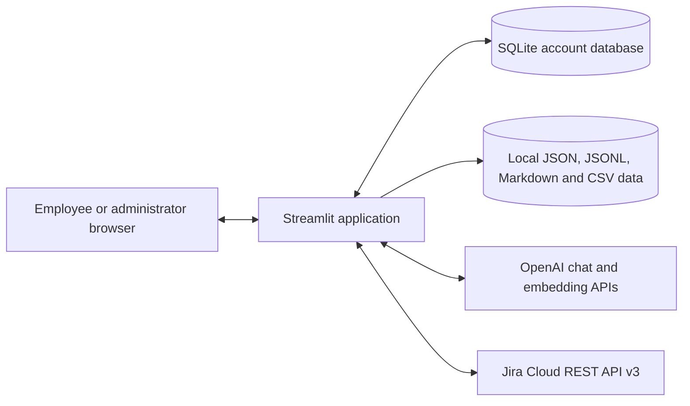

# SmartDeskAI System Design

## 1. Purpose and scope

SmartDeskAI is a Streamlit-based employee support application for the fictional
SmartHR Solutions organization. It brings HR and IT knowledge search, common
employee self-service pages, local account management, and optional Jira
workflows into one authenticated web app.

This document describes the implementation in `SmartDesk/` and `data/`; it is
not a proposed multi-service or production-scale redesign. For visual
architecture diagrams, see [ARCHITECTURE.svg](./ARCHITECTURE.svg) and
[HYBRID_RAG.svg](./HYBRID_RAG.svg); their editable Graphviz sources are
[ARCHITECTURE.dot](./ARCHITECTURE.dot) and [HYBRID_RAG.dot](./HYBRID_RAG.dot).

## 2. System context

The application is a single Python process: Streamlit renders the interface and
calls authentication, retrieval, workflow, and integration logic directly.
There is no separate application API or independently deployed retrieval
service. SQLite is used for accounts and login-attempt state; knowledge and
reference data are read from files under `data/`.

## 3. Application components

| Component | Responsibility |
|---|---|
| Streamlit UI — `SmartDesk/smartHR_app.py` | Sign-in, navigation, chat, user/admin pages, forms, data tables, document display, and generated-letter previews/downloads. |
| Authentication — `SmartDesk/smartHR_auth.py` | SQLite schema and account operations; password hashing/verification with Argon2id; initial-admin bootstrap; login throttling; active-user and session-version checks; admin account management. |
| Support and integration logic — `SmartDesk/smartHR.py` | Load and normalize knowledge files, prepare retrieval indexes, define assistant tools and prompt, run the tool-calling chat loop, and call Jira APIs. |
| Knowledge sources — `data/*.json`, `data/*.jsonl`, `data/policies/*.md` | Helpdesk records, FAQ/policy Q&A, and policy documents used by assistant retrieval. |
| Reference sources — `data/*.csv` | Company directory, holiday calendar, and fictional employment-verification test records. |
| Account store — `data/smarthr_auth.sqlite3` | User records and login-attempt timestamps. It is separate from the knowledge and reference files. |
| OpenAI services | `text-embedding-3-small` embeddings for indexing and a configurable chat model (default `gpt-4o-mini`) for assistant responses. |
| Jira Cloud | Optional issue creation, issue lookup by key, and issue listing by requester email within the configured Jira project. |

### User-facing capabilities

- **Support Chat:** answers knowledge questions with retrieval tools; can offer a user-reviewed Jira ticket draft when it cannot find a reliable answer.
- **Jira:** separate pages to create an issue or query issues, in addition to the chat tools.
- **Employee reference:** searchable fictional company directory, org chart, holiday calendar, and policy document pages.
- **Employment letters:** a fictional-data test page for signed-in users and an admin-only official-letter form using HR-entered, verified details. Generated letters are presented for download and are not saved to the account database.
- **Administration:** admins can create users, reset passwords, and enable or disable accounts.

## 4. Support-chat and retrieval design

### Knowledge ingestion

On the first support-chat request in a process, `initialize_agent()` constructs
the support manager, indexes, tools, and chat model. JSON and JSONL files
directly inside `data/` are loaded. JSON records accept `question` or `subject`
and `answer` or `description`, with a category. JSONL records are converted
from their last user and assistant messages. Markdown files in
`data/policies/` are split into headed sections. Records are normalized with
their source and metadata before indexing.

The normalized document set is split into token chunks (2,048 tokens with 50
tokens of overlap) and used to build:

1. A semantic `VectorStoreIndex` with `text-embedding-3-small`.
2. A `SimpleKeywordTableIndex` over the same nodes.

These indexes are built in application memory; the implementation does not
configure a persistent vector database. Policy search filters to policy
records, so ticket records cannot dominate policy results.

### Query flow

1. The authenticated user submits a question in the Streamlit chat.
2. The app supplies recent conversation turns and the system prompt to the
   chat model.
3. The model selects one or more registered tools, such as policy search,
   similar-ticket search, directory lookup, holiday lookup, or Jira query.
4. Similar-ticket search first checks for a normalized exact subject match. If
   none is found, it retrieves semantic and keyword candidates and combines
   their rankings with reciprocal-rank fusion, deduplicating by record ID and
   returning up to three results. Policy search uses the same hybrid ranking
   approach with policy-only candidates.
5. Tool output is added to the conversation and sent back to the model for a
   grounded response. The assistant prompt instructs it to cite available
   sources, avoid inventing information, and report when evidence is
   insufficient.
6. If the response begins with `[NO_ANSWER]`, the UI offers the employee an
   optional Jira issue form. The employee reviews and submits the issue
   separately; an issue is created only after the required details are
   provided and the user confirms.

The tool loop permits up to five model iterations. Chat messages and pending
form state are held in Streamlit session state for the current browser session.

## 5. Jira workflow

Jira operations are made directly from the application using HTTPS REST API
v3 calls. Issue creation validates the submitted email and required fields,
maps the support priority to the configured Jira priority, and returns the
created issue key and URL. Query operations accept either an issue key from the
configured project or a requester work email; email queries are paginated.

Jira access is optional and requires deployment configuration. The Jira API
token and account email are read from environment settings and must not be
stored in source control or exposed to end users.

## 6. Authentication and authorization

At startup, the app initializes its SQLite tables and attempts to create the
first administrator only when the account database is empty and both bootstrap
settings are present. Passwords are stored as Argon2id hashes, not plaintext.
Login attempts are limited per normalized username over a 15-minute window.
The database file is restricted to owner-only permissions where supported.

The Streamlit session stores public user fields, not password material. Each
rerun checks that the account is still active and that its session version has
not changed. Admin-only pages and actions are gated by the authenticated
account role. Password reset increments the session version, invalidating
existing sessions for that account.

## 7. Data and configuration

| Data/configuration | Purpose |
|---|---|
| `data/*.json`, `data/*.jsonl` | Assistant knowledge records; only direct-child JSON/JSONL files are indexed. |
| `data/policies/*.md` | Policy content for both policy browsing and policy retrieval. |
| `data/company_directory.csv` | Directory and org-chart source; current sample data is fictional. |
| `data/holiday_calendar.csv` | Holiday reference dates; not a company-specific paid-holiday schedule. |
| `data/employment_verification_testdata.csv` | Fictional employment-verification test records. |
| `data/smarthr_auth.sqlite3` | Local account and login-attempt data. |
| Environment variables or Streamlit secrets | OpenAI, initial-admin, chat-model, and Jira integration settings. |

Important settings include `OPENAI_API_KEY`,
`SMART_HR_ADMIN_USERNAME`, `SMART_HR_ADMIN_PASSWORD`,
`OPENAI_CHAT_MODEL`, `JIRA_BASE_URL`, `JIRA_EMAIL`, `JIRA_API_TOKEN`,
`JIRA_PROJECT_KEY`, and `JIRA_ISSUE_TYPE`. `JIRA_PRIORITY_MAP` can optionally
override support-to-Jira priority mapping. See [README.md](./README.md) for
setup details. Do not put secret values in this document or commit a `.env`
file.

## 8. Deployment and operational boundaries

The app is started with Streamlit from the `SmartDeskAI` project directory.
The README also describes Streamlit Community Cloud configuration. The
deployed environment needs outbound access to OpenAI and, when Jira workflows
are enabled, Jira Cloud. The local SQLite database must reside on storage
appropriate for the deployment and its persistence model.

The directory and employment-verification sample data are fictional. The
holiday file is a reference calendar, not a company holiday policy. Replace
sample/reference data only with approved content before treating the app as an
authoritative employee service. The UI warns users not to enter passwords,
MFA codes, or other sensitive information into chat.

## 9. Key implementation files

- [Streamlit application](./SmartDesk/smartHR_app.py)
- [Support, retrieval, and Jira workflows](./SmartDesk/smartHR.py)
- [Authentication and account persistence](./SmartDesk/smartHR_auth.py)
- [Project setup and operational guidance](./README.md)
